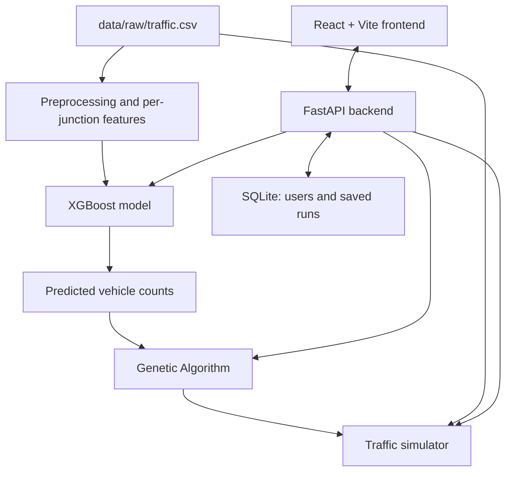

# Traffic-AI
### AI-Based Adaptive Traffic Signal Optimization Using XGBoost and a Genetic Algorithm

Traffic-AI is an MCA mini-project that combines machine learning and optimization to explore how traffic signals can respond to changing traffic demand. It predicts vehicle volume with an XGBoost regression model, uses a Genetic Algorithm to suggest green-light timings, and compares Fixed-Time and Adaptive signal strategies in a traffic simulator.

> **Important:** This is a prototype for learning and demonstration. It uses hourly vehicle counts from a CSV and simulated signal results; it is not connected to live road sensors and does not control real traffic lights.

## Project Objectives

- Prepare and analyse hourly vehicle-count data for four junctions.
- Predict future hourly vehicle counts (traffic volume) with XGBoost.
- Optimize green-light allocation across four approaches with a Genetic Algorithm.
- Simulate and compare a Fixed-Time plan and the GA-optimized (Adaptive) plan.
- Present observed data, predictions, signal plans and simulation results through a React dashboard backed by FastAPI.

## How It Works

1. **Data preprocessing:** parse and validate `data/raw/traffic.csv`, add calendar features and per-junction lag/rolling features.
2. **Prediction:** the saved XGBoost model predicts the next hours' vehicle count for a junction.
3. **Signal optimization:** the Genetic Algorithm allocates one cycle's green time across four approaches using predicted demand.
4. **Simulation:** the simulator runs Fixed-Time and GA-optimized plans on identical random arrivals built from the CSV counts.
5. **Dashboard:** React shows everything, each section labelled **Observed**, **Predicted** or **Simulated**.



## Dataset

- File: `data/raw/traffic.csv` (project-relative; override with the `TRAFFIC_AI_DATA` environment variable).
- **48,120 hourly records**, 2015-11-01 00:00 to 2017-06-30 23:00.
- Source: the upload does not document its origin, so none is claimed here. It has the layout of a public hourly junction-count dataset, but that was not verified.

| Column | Meaning |
|---|---|
| `DateTime` | Hour of the observation |
| `Junction` | Junction ID (1-4). Real-world locations are **not** documented and are not assumed |
| `Vehicles` | Number of vehicles counted in that hour (target) |
| `ID` | Record identifier (never used as a feature) |

Facts computed from the file (also shown on the dashboard):

| Junction | Records | Mean / hour | Min | Max | First record |
|---|---|---|---|---|---|
| 1 | 14,592 | 45.05 | 5 | 156 | 2015-11-01 |
| 2 | 14,592 | 14.25 | 1 | 48 | 2015-11-01 |
| 3 | 14,592 | 13.69 | 1 | 180 | 2015-11-01 |
| 4 | 4,344 | 7.25 | 1 | 36 | **2017-01-01** |

- No missing values, no duplicate rows or IDs, and no gaps in each junction's hourly sequence. All 48,120 records are kept unchanged.
- **Junction 4 only has data from 2017-01-01**, so scenarios that need all four junctions can only start from 2017-01-08 (a week of history is needed for the lag features). The API explains this when a start time is out of range.
- Traffic grows strongly over the period (for example, Junction 1 averages about 20/hour in Nov 2015 and 73/hour in Jun 2017). The model is therefore tested on a period with higher traffic than most of its training data.
- The busiest hours of the day in this data are around 12:00 and 19:00-20:00 (not the usual 07:00-09:00 morning peak).
- **Not in the CSV:** vehicle categories, lane/approach counts, queue lengths, waiting times, signal timings, junction locations.

## Data Preprocessing

`backend/preprocessing.py`: validates columns, parses `DateTime`, converts `Junction`/`Vehicles` to integers, rejects negative counts, reports missing values/duplicates/gaps, and sorts chronologically. Nothing is imputed or generated. Features: `Junction`, `hour`, `day`, `month`, `weekday`, `is_weekend`, `lag_1/2/3/24/168`, `roll_mean_3/24`. Lags and rolling means are computed **per junction** and rolling means use only earlier hours (shifted by one), so the value being predicted is never an input. The first week of each junction is dropped from the model table only because it lacks lag history (47,448 model rows). `Junction` is passed to XGBoost as a numeric ID (a label, not a quantity).

## XGBoost Methodology

- Target: `Vehicles`, the hourly count of a junction (traffic volume, not individual vehicle movements).
- Split: chronological. The earlier 80% of timestamps are used for training (2015-11-08 to 2017-03-02), the later 20% for testing (2017-03-02 to 2017-06-30).
- Saved to `models/traffic_xgb_model.joblib` with metadata in `models/model_metadata.json`; the API loads these files and refuses to use a model trained with different features.
- `/api/v1/predict` forecasts after the end of the data, feeding each prediction back as history (so errors grow with the horizon), or from an earlier `as_of` time so predictions can be checked against the observed counts.

## Model Evaluation

Metrics computed by the code on the held-out test set (`11,540` rows, one-hour-ahead predictions, vehicles per hour). Re-running training regenerates them.

| Model | MAE | RMSE | R² |
|---|---|---|---|
| XGBoost (saved model) | 2.765 | 4.444 | 0.972 |
| Baseline: same as last hour | 3.806 | 5.721 | 0.954 |
| Baseline: same hour yesterday | 5.911 | 10.183 | 0.855 |
| Baseline: same hour last week | 4.329 | 7.412 | 0.923 |

XGBoost's MAE is 27.4% lower than the best baseline (last hour).

Same features and split, three regression models (`backend/model_comparison.py`):

| Model | MAE | RMSE | R² |
|---|---|---|---|
| Linear Regression | 3.118 | 4.772 | 0.968 |
| Random Forest | 2.958 | 4.802 | 0.968 |
| XGBoost | 2.765 | 4.444 | 0.972 |

XGBoost per junction:

| Junction | Test rows | MAE | RMSE | R² |
|---|---|---|---|---|
| Junction 1 | 2,885 | 4.033 | 5.894 | 0.938 |
| Junction 2 | 2,885 | 2.293 | 2.913 | 0.876 |
| Junction 3 | 2,885 | 2.927 | 5.453 | 0.728 |
| Junction 4 | 2,885 | 1.804 | 2.459 | 0.497 |

Junction 4 has a low R² because its counts are small and noisy; its MAE is the smallest in absolute terms.

## Genetic Algorithm Methodology

`backend/genetic_algorithm.py`. A chromosome is four integer green times (one per approach). Configurable: cycle length (default 120 s), minimum green (10 s), maximum green (60 s), lost time per phase (4 s), population size, generations (also settable from the Analytics page and `POST /api/v1/optimize`). Impossible settings return a clear error.

- Greens must lie in [min, max] and sum to cycle minus total lost time; a repair step enforces this and the fitness adds a large penalty for any violation (safety net).
- Fitness = demand-weighted average delay per vehicle, **estimated** with Webster's uniform-delay formula plus a penalty for oversaturation. Lower is better.
- Tournament selection, uniform crossover, move-seconds mutation, elitism. The equal-split Fixed-Time plan is in the initial population, so the result is never worse than it.
- Demand = XGBoost-predicted counts of the selected hour × a demand multiplier (default 3×, a simulation assumption that makes a small count loading meaningful for a signal).

**Key assumption:** the CSV has junction counts, not per-approach counts. The simulator treats Approach 1-4 of one hypothetical four-way intersection as having the demand of Junction 1-4. This is a modelling choice for demonstration, not a real layout.

Example (generated by the code for 2017-03-02 19:00, multiplier 3): optimized greens 60/16/18/10 s vs 26/26/26/26 s for Fixed-Time, estimated delay about 25% lower. Estimated delays are formula outputs, not measured waiting times.

## Simulation

`backend/simulator.py`: one-second custom simulator (SUMO is not used). Poisson arrivals are generated from the observed hourly counts × multiplier; both controllers see the same arrivals per seed. Fixed-Time uses the equal split; Adaptive re-plans with the GA every simulated hour using XGBoost predictions. Queues, waits and vehicles served are **simulated**. In an example run (start 2017-03-02 19:00, 1 hour, multiplier 3, 3 seeds) average simulated wait was about 48 s for Fixed-Time and 31 s for the optimized plan; results change with the start time, multiplier and seeds and are not real-world measurements.

## Limitations

- Counts are hourly traffic volume; no lane, queue, waiting-time or signal data exist in the CSV, so those are simulated or estimated.
- The four-approach intersection is built from four junctions' counts (assumption above); the demand multiplier is an assumption.
- Predictions beyond the end of the data are recursive and less reliable for long horizons.
- Traffic in the data trends upward, so tree models see test-period levels that are higher than most training data.
- One dataset of about 20 months; Junction 4 has under 6 months. Month is a feature but no full yearly cycle is available for every junction.
- The project does not control real traffic signals.

## Technology Stack

| Area | Technologies |
|---|---|
| Programming languages | Python, JavaScript |
| Frontend | React, Vite, Tailwind CSS |
| Backend/API | FastAPI, Uvicorn, Pydantic |
| Machine learning | XGBoost, scikit-learn |
| Data processing | Pandas, NumPy |
| Database | SQLite |
| Charts/UI | Recharts, Framer Motion, Lucide React |
| Testing | pytest, HTTPX |
| Notebooks | Jupyter Notebook |

## Project Structure

```text
Traffic-AI/
├── backend/
│   ├── main.py                 # FastAPI application and endpoints
│   ├── auth.py                 # Authentication utilities
│   ├── db.py                   # Database operations
│   ├── preprocessing.py        # Data cleaning and feature engineering
│   ├── model.py                # Model loading/training and prediction
│   ├── model_comparison.py     # Model comparison utilities
│   ├── genetic_algorithm.py    # Green-time optimization
│   └── simulator.py            # Traffic simulation
├── data/
│   ├── raw/
│   │   ├── traffic.csv         # Source dataset (used by the whole project)
│   │   └── traffic_ai.csv      # Older dataset from the first version (no longer used)
│   ├── processed/
│   │   ├── traffic_clean.csv
│   │   └── traffic_features.csv
│   └── traffic_ai.db           # Local SQLite database (if generated/used)
├── frontend/
│   ├── package.json
│   ├── vite.config.js
│   └── src/
│       ├── App.jsx
│       ├── main.jsx
│       ├── index.css
│       └── utils.js
├── models/
│   ├── traffic_xgb_model.joblib
│   ├── model_metadata.json
│   └── model_comparison.json
├── Notebooks/
│   ├── 01_Data_Analysis.ipynb
│   ├── 02_XGBoost_Training.ipynb
│   ├── 03_Model_Evaluation.ipynb
│   └── Model_Comparison.ipynb
├── tests/
│   ├── conftest.py
│   ├── test_api.py
│   ├── test_auth.py
│   ├── test_db.py
│   ├── test_genetic_algorithm.py
│   ├── test_model.py
│   └── test_preprocessing.py
├── requirements.txt
└── README.md
```

## Requirements

- Python 3.11 or a version compatible with the packages in `requirements.txt`
- Node.js and npm compatible with the Vite version in `frontend/package.json`
- Git (optional)

## Run Locally on Windows

Open a terminal in the project root (`Traffic-AI`).

### 1. Create and activate a Python virtual environment

```powershell
python -m venv .venv
.\.venv\Scripts\Activate.ps1
```

If PowerShell blocks activation, use Command Prompt instead:

```bat
.venv\Scripts\activate.bat
```

### 2. Install backend dependencies

```powershell
python -m pip install --upgrade pip
pip install -r requirements.txt
```

### 3. Prepare data and train the model (if needed)

The repository includes processed data and a saved model artifact. If you want to regenerate them, run:

```powershell
python -m backend.preprocessing
python -m backend.model
```

Run these commands from the project root. Check the console output for any dataset or dependency errors.

### 4. Install frontend dependencies

```powershell
cd frontend
npm install
cd ..
```

### 5. Start the FastAPI backend

From the project root, with the virtual environment activated:

```powershell
uvicorn backend.main:app --reload
```

- API server: http://127.0.0.1:8000
- Interactive API documentation: http://127.0.0.1:8000/docs

### 6. Start the React frontend

Open a **second terminal** in the project root:

```powershell
cd frontend
npm run dev
```

Open the local address printed by Vite in the terminal (commonly `http://localhost:5173`). Keep both terminal windows running while using the app.

## Tests

```powershell
python -m pytest -q
```

The suite covers data loading and preprocessing, per-junction lag features, model training and prediction, GA constraints, the simulator, authentication, the database and the API endpoints.
