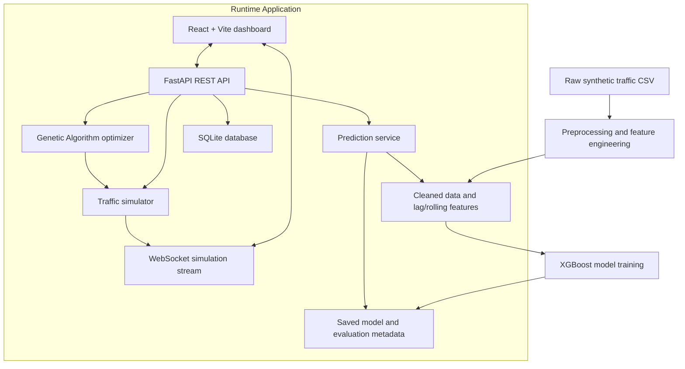

# Traffic-AI — Adaptive Traffic Signal Optimization

> **XGBoost-Based Traffic Volume Prediction and Genetic Algorithm-Based Signal Optimization**

**Project Title:** AI-Based Adaptive Traffic Signal Optimization Using XGBoost Prediction and Genetic Algorithm

Traffic-AI is an MCA mini-project that forecasts hourly vehicle counts using XGBoost, optimizes green-light timings for a four-way intersection using a Genetic Algorithm (GA), and compares Fixed-Time and Adaptive traffic signal controllers in a simple traffic simulator. A React dashboard communicates with a FastAPI backend and receives live simulation updates over WebSockets.

## Dataset Used

This project uses the synthetic dataset **Synthetic Traffic Volume Data for ML Projects**, published on Kaggle by `sanathshukla`:

https://www.kaggle.com/datasets/sanathshukla/synthetic-traffic-volume-data-for-ml-projects

The CSV is stored at `data/raw/traffic_ai.csv`. It contains 12,000 synthetically generated hourly records across four junctions, covering 2024-01-01 to 2024-05-04, with columns `ID`, `DateTime`, `Junction`, and `Vehicles`.

**Dataset limitation:** These are synthetic values, not real-world traffic measurements. The junction-level counts are used as a modelling input for the simulator; they are not actual North, South, East, and West approach measurements.

## About the Project

The application combines traffic-data preprocessing, time-series feature engineering, vehicle-count prediction, traffic-signal optimization, simulation, and a web dashboard. The application labels values as:

- **Observed** — values read from the supplied dataset.
- **Predicted** — vehicle counts forecast by the trained XGBoost model.
- **Simulated** — estimated queues, waiting times, vehicles served, and signal timings produced by the simulator.

## System Architecture

The project has an offline data/model workflow and a runtime application workflow. Preprocessing creates cleaned data and time-based features; model training evaluates XGBoost against simple baselines. At runtime, FastAPI serves predictions and optimization results, SQLite stores user accounts and run summaries, and the React frontend presents the results.



## Core Components

- **Data Preprocessing** — validates the input CSV, reports missing values, duplicates, and hourly gaps, and creates time-based, lag, and rolling-mean features.
- **Traffic Volume Prediction** — trains an XGBoost regression model to predict vehicle counts one hour ahead. Evaluation uses a chronological 80/20 split and reports MAE, RMSE, and R² against last-hour and same-hour-yesterday baselines.
- **Genetic Algorithm** — searches for green-light allocations across four approaches. It uses tournament selection, uniform crossover, mutation, and elitism while respecting green-time and cycle constraints.
- **Traffic Simulation** — compares Fixed-Time and Adaptive controllers using the same arrivals for a given random seed. Adaptive signal plans use predicted demand.
- **FastAPI Backend** — provides authentication, traffic history and summary, prediction, optimization, simulation, comparison, saved-run, and health endpoints.
- **React Dashboard** — includes Login, Dashboard, Traffic Prediction, Signal Simulation, and Analytics pages.
- **SQLite Storage** — stores user accounts and summaries from optimization, comparison, and simulation runs.

## Tech Stack

- **Language:** Python, JavaScript
- **Backend:** FastAPI, Uvicorn, Pydantic
- **Frontend:** React, Vite, Tailwind CSS
- **Machine Learning:** XGBoost, scikit-learn
- **Data Processing:** Pandas, NumPy
- **Visualization:** Recharts, Framer Motion, Lucide React
- **Database:** SQLite, SQLAlchemy
- **Real-time Updates:** WebSockets
- **Testing:** pytest, HTTPX
- **Version Control:** Git and GitHub
- **Optional Container Setup:** Docker and Docker Compose

## Project Structure

```text
Traffic-AI/
├── backend/
│   ├── __init__.py
│   ├── main.py                  # FastAPI application and API endpoints
│   ├── auth.py                  # Password hashing and token authentication
│   ├── db.py                    # SQLite database operations
│   ├── preprocessing.py         # Data cleaning and feature engineering
│   ├── model.py                 # XGBoost training, loading, and prediction
│   ├── genetic_algorithm.py     # Genetic Algorithm for green-time optimization
│   └── simulator.py             # Fixed-Time and Adaptive traffic simulation
│
├── data/
│   ├── raw/
│   │   └── traffic_ai.csv       # Original synthetic traffic dataset
│   ├── processed/
│   │   ├── traffic_clean.csv    # Cleaned traffic data
│   │   └── traffic_features.csv # Processed data with engineered features
│   ├── traffic_ai.db            # SQLite database (created/used by the app)
│   └── .secret_key              # Local authentication signing key; do not commit
│
├── frontend/
│   ├── index.html
│   ├── package.json             # Frontend dependencies and commands
│   ├── package-lock.json
│   ├── vite.config.js           # Vite development server and API proxy
│   ├── tailwind.config.js
│   ├── postcss.config.js
│   └── src/
│       ├── main.jsx             # React entry point
│       ├── App.jsx              # Main application component
│       ├── index.css             # Global styles
│       ├── api/
│       │   └── client.js         # HTTP API client
│       ├── components/
│       │   ├── Layout.jsx
│       │   ├── ScenarioForm.jsx
│       │   ├── SignalBox.jsx
│       │   ├── charts.jsx
│       │   └── ui.jsx
│       ├── hooks/
│       │   ├── useApi.js
│       │   └── useSimulationSocket.js
│       ├── pages/
│       │   ├── Login.jsx
│       │   ├── Dashboard.jsx
│       │   ├── Prediction.jsx
│       │   ├── Simulation.jsx
│       │   └── Analytics.jsx
│       └── utils.js
│
├── Notebooks/
│   ├── 01_Data_Analysis.ipynb
│   ├── 02_XGBoost_Training.ipynb
│   └── 03_Model_Evaluation.ipynb
│
├── models/
│   ├── traffic_xgb_model.joblib # Trained XGBoost model artifact
│   ├── model_metadata.json      # Training details and evaluation metrics
│   └── .gitkeep
│
├── tests/
│   ├── conftest.py
│   ├── test_api.py
│   ├── test_auth.py
│   ├── test_db.py
│   ├── test_genetic_algorithm.py
│   ├── test_model.py
│   └── test_preprocessing.py
│
├── .gitignore
├── .dockerignore
├── Dockerfile
├── docker-compose.yml
├── requirements.txt
└── README.md
```

## Run Locally on Windows

### 1. Requirements

- Windows 10/11
- Python 3.11 or newer
- Node.js and npm compatible with the installed Vite version
- Git (optional, for cloning and version control)

### 2. Set up Python environment

Run these commands from the project root (`Traffic-AI`):

```powershell
python -m venv .venv
.venv\Scripts\Activate
pip install -r requirements.txt
```

### 3. Prepare data and train the model

```powershell
python -m backend.preprocessing
python -m backend.model
```

Preprocessing writes the processed CSV files under `data/processed/`. Model training saves `models/traffic_xgb_model.joblib` and `models/model_metadata.json`.

### 4. Install frontend dependencies

```powershell
cd frontend
npm install
cd ..
```

### 5. Start the backend

From the project root, with the virtual environment activated:

```powershell
uvicorn backend.main:app --reload
```

- API base: http://127.0.0.1:8000
- Interactive API documentation: http://127.0.0.1:8000/docs
- Health endpoint: http://127.0.0.1:8000/api/v1/health

### 6. Start the frontend

Open a second terminal at the project root:

```powershell
cd frontend
npm run dev
```

Open http://localhost:5173. Use **Create an account** on the login page to register a user, then sign in. Vite proxies `/api` and `/ws` requests to the backend on port 8000.

## Main API Routes

| Method | Route | Purpose |
|---|---|---|
| `GET` | `/api/v1/health` | Checks API, dataset, and model availability. |
| `POST` | `/api/v1/auth/register` | Creates a user account. |
| `POST` | `/api/v1/auth/login` | Authenticates a user and returns a token. |
| `GET` | `/api/v1/auth/me` | Returns the authenticated user. |
| `GET` | `/api/v1/model-info` | Returns model metadata. |
| `GET` | `/api/v1/traffic/summary` | Returns dataset and traffic summary statistics. |
| `GET` | `/api/v1/traffic/history` | Returns observed history for a junction. |
| `POST` | `/api/v1/predict` | Predicts vehicle counts for a junction and forecast horizon. |
| `POST` | `/api/v1/optimize` | Calculates a traffic signal timing plan. |
| `POST` | `/api/v1/simulation/start` | Starts a simulation scenario. |
| `POST` | `/api/v1/simulation/step` | Advances a simulation. |
| `POST` | `/api/v1/simulation/stop` | Stops the running simulation. |
| `POST` | `/api/v1/simulation/reset` | Resets simulation state. |
| `GET` | `/api/v1/simulation/state` | Returns the current simulation state. |
| `POST` | `/api/v1/compare` | Compares controllers across random seeds. |
| `GET` | `/api/v1/runs` | Lists saved run summaries. |
| `DELETE` | `/api/v1/runs` | Clears saved run summaries. |
| `WebSocket` | `/ws/simulation` | Streams live simulation updates. |

Most traffic, model, optimization, and simulation routes require a valid login token. The health and authentication routes are public.

## Simulation Assumptions and Limitations

- The dataset is synthetic and contains junction-level hourly counts; it does not contain real measurements for individual compass-direction approaches.
- The simulator maps junction demand to four approaches as a modelling assumption.
- The default demand multiplier scales dataset counts for simulation. Simulation results depend on this setting.
- Adaptive control plans using predicted demand, while simulated arrivals use observed demand. If the model prediction is inaccurate, Adaptive control may not outperform Fixed-Time control.
- The simulator is intentionally simplified: one lane per approach, a fixed 120-second cycle, and no turning movements.
- The authentication flow is suitable for a local mini-project demonstration, not a production deployment. Configure secrets safely before exposing the app publicly.

## Tests

From the project root, activate the virtual environment and run:

```powershell
pytest
```

The test suite covers preprocessing, model training and prediction, Genetic Algorithm constraints, simulation, authentication, database operations, and API endpoints.

## Future Improvements

- Validate the system against real-world traffic sensor data.
- Extend the simulator to support turning movements, lane-specific demand, and richer road-network layouts.
- Evaluate additional forecasting models and tune model parameters systematically.
- Improve authentication, configuration, and deployment security for production use.

---

**Project type:** MCA Mini Project  
**Main objective:** Predict traffic volume and optimize signal green times using machine learning and a Genetic Algorithm.
