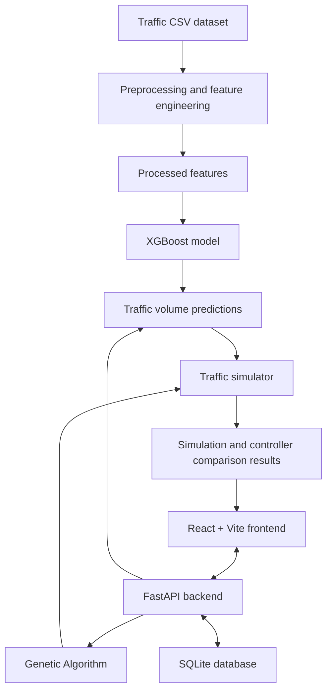

# Traffic-AI
### AI-Based Adaptive Traffic Signal Optimization Using XGBoost and a Genetic Algorithm

Traffic-AI is an MCA mini-project that combines machine learning and optimization to explore how traffic signals can respond to changing traffic demand. It predicts vehicle volume with an XGBoost regression model, uses a Genetic Algorithm to suggest green-light timings, and compares Fixed-Time and Adaptive signal strategies in a traffic simulator.

> **Important:** This is a prototype for learning and demonstration. It uses synthetic traffic data and simulated results; it is not connected to live road sensors or real traffic lights.

## Project Objectives

- Prepare and analyse hourly traffic-volume data.
- Predict future vehicle counts using XGBoost.
- Optimize green-light allocation across four approaches using a Genetic Algorithm.
- Simulate and compare Fixed-Time and Adaptive signal controllers.
- Present predictions, signal plans, and simulation results through a React dashboard backed by a FastAPI API.

## How It Works

1. **Data preprocessing:** Clean the source CSV and create time-based, lag, and rolling features.
2. **Prediction:** Use the trained XGBoost model to forecast traffic volume.
3. **Signal optimization:** The Genetic Algorithm searches for green-time allocations within configured constraints.
4. **Simulation:** The simulator evaluates Fixed-Time and Adaptive strategies under the same simulation settings.
5. **Dashboard:** The React frontend communicates with FastAPI to display application data and results.

### Architecture



## Main Features

- **Traffic data analysis** using Pandas and NumPy.
- **Vehicle-volume forecasting** using XGBoost.
- **Model evaluation and comparison** with stored evaluation metadata.
- **Genetic Algorithm optimization** for four-way signal green times.
- **Fixed-Time vs Adaptive simulation** to compare simulated outcomes.
- **REST API** built with FastAPI.
- **React dashboard** built with Vite.
- **SQLite storage** for application data and run summaries.
- **Automated tests** using pytest.

## Dataset

The project uses the synthetic dataset **Synthetic Traffic Volume Data for ML Projects**:

- Dataset page: https://www.kaggle.com/datasets/sanathshukla/synthetic-traffic-volume-data-for-ml-projects
- Local file: `data/raw/traffic_ai.csv`
- The dataset contains hourly records with fields such as `ID`, `DateTime`, `Junction`, and `Vehicles`.

**Dataset limitation:** The values are synthetically generated, not real-world traffic measurements. The dataset provides junction-level counts, not measured vehicle counts for individual North, South, East, and West approaches. Mapping demand to four approaches is a simulator assumption.

## Technology Stack

| Area | Technologies |
|---|---|
| Programming languages | Python, JavaScript |
| Frontend | React, Vite, Tailwind CSS |
| Backend/API | FastAPI, Uvicorn, Pydantic |
| Machine learning | XGBoost, scikit-learn |
| Data processing | Pandas, NumPy |
| Database | SQLite |
| Charts/UI | Recharts, Framer Motion, Lucide React |
| Testing | pytest, HTTPX |
| Notebooks | Jupyter Notebook |

## Project Structure

```text
Traffic-AI/
├── backend/
│   ├── main.py                 # FastAPI application and endpoints
│   ├── auth.py                 # Authentication utilities
│   ├── db.py                   # Database operations
│   ├── preprocessing.py        # Data cleaning and feature engineering
│   ├── model.py                # Model loading/training and prediction
│   ├── model_comparison.py     # Model comparison utilities
│   ├── genetic_algorithm.py    # Green-time optimization
│   └── simulator.py            # Traffic simulation
├── data/
│   ├── raw/
│   │   └── traffic_ai.csv      # Source dataset
│   ├── processed/
│   │   ├── traffic_clean.csv
│   │   └── traffic_features.csv
│   └── traffic_ai.db           # Local SQLite database (if generated/used)
├── frontend/
│   ├── package.json
│   ├── vite.config.js
│   └── src/
│       ├── App.jsx
│       ├── main.jsx
│       ├── index.css
│       └── utils.js
├── models/
│   ├── traffic_xgb_model.joblib
│   ├── model_metadata.json
│   └── model_comparison.json
├── Notebooks/
│   ├── 01_Data_Analysis.ipynb
│   ├── 02_XGBoost_Training.ipynb
│   ├── 03_Model_Evaluation.ipynb
│   └── Model_Comparison.ipynb
├── tests/
│   ├── conftest.py
│   ├── test_api.py
│   ├── test_auth.py
│   ├── test_db.py
│   ├── test_genetic_algorithm.py
│   ├── test_model.py
│   └── test_preprocessing.py
├── requirements.txt
└── README.md
```

## Requirements

- Python 3.11 or a version compatible with the packages in `requirements.txt`
- Node.js and npm compatible with the Vite version in `frontend/package.json`
- Git (optional)

## Run Locally on Windows

Open a terminal in the project root (`Traffic-AI`).

### 1. Create and activate a Python virtual environment

```powershell
python -m venv .venv
.\.venv\Scripts\Activate.ps1
```

If PowerShell blocks activation, use Command Prompt instead:

```bat
.venv\Scripts\activate.bat
```

### 2. Install backend dependencies

```powershell
python -m pip install --upgrade pip
pip install -r requirements.txt
```

### 3. Prepare data and train the model (if needed)

The repository includes processed data and a saved model artifact. If you want to regenerate them, run:

```powershell
python -m backend.preprocessing
python -m backend.model
```

Run these commands from the project root. Check the console output for any dataset or dependency errors.

### 4. Install frontend dependencies

```powershell
cd frontend
npm install
cd ..
```

### 5. Start the FastAPI backend

From the project root, with the virtual environment activated:

```powershell
uvicorn backend.main:app --reload
```

- API server: http://127.0.0.1:8000
- Interactive API documentation: http://127.0.0.1:8000/docs

### 6. Start the React frontend

Open a **second terminal** in the project root:

```powershell
cd frontend
npm run dev
```

Open the local address printed by Vite in the terminal (commonly `http://localhost:5173`). Keep both terminal windows running while using the app.

## Tests

From the project root, activate the virtual environment and run:

```powershell
pytest
```

Tests may require the dependencies and local configuration described above.

## Limitations

- The dataset is synthetic, so results do not establish real-world traffic forecasting accuracy.
- Traffic arrivals, queues, and waiting times are simulated estimates, not live observations.
- The simulator simplifies real intersections and road behaviour.
- Model performance depends on the dataset, feature engineering, and training setup.
- This project is intended for academic demonstration, not direct control of public-road traffic infrastructure.

## Future Scope

- Evaluate the model with real traffic-sensor data.
- Add weather, holidays, events, and road-condition features.
- Improve simulation realism with lane-level demand and turning movements.
- Compare additional forecasting models using consistent evaluation metrics.
- Strengthen secret management, authentication, logging, and deployment configuration.

---

**Project Type:** MCA Mini Project  
**Project Focus:** Machine-learning-based traffic volume prediction and adaptive signal-timing optimization.
